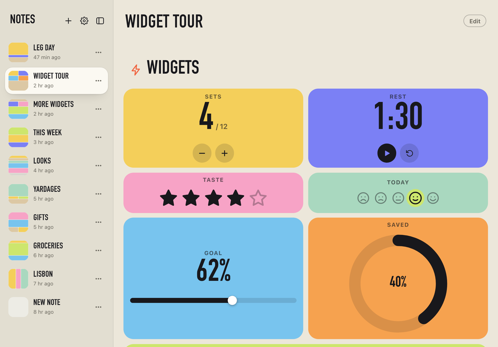
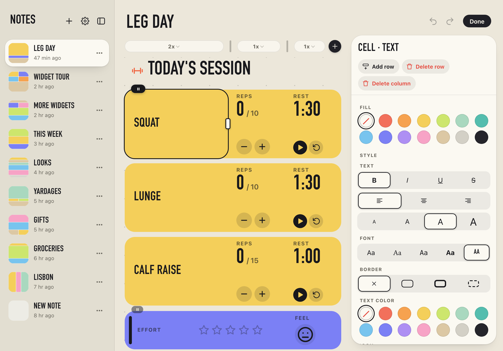
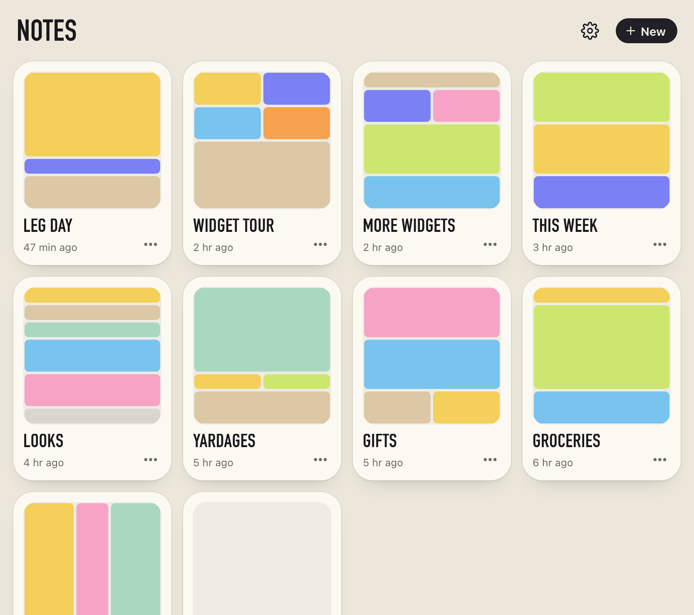

# Euclidnote

Cell-based, mobile-first notes that you glance at: counters, timers, checklists, ratings, little charts and trackers, laid out on one grid of big, friendly cells. It is a progressive web app, so it installs to a home screen or dock and works offline. Notes stay on your device.



| Editing: a cell selected, with its inspector | The page of notes |
| --- | --- |
|  |  |

*Screenshots are the example notes on an 11-inch tablet (`npm run screenshots`).*

## What it does

- **One grid per note.** Eighteen kinds of cell (text, checkbox, switch, link, counter, timer, number, rating, mood, progress, steps, habit, chart, tag, date, time, countdown, badge) sit on a grid. Gather cells into **groups** with a shared look (card, table, header, sidebar, stripe, stack, tiles, outline) and a color. Notes scroll down or sideways; positions are the same either way.
- **View is calm, Edit is direct.** Viewing a note only lets you use widgets. Edit mode is for changing things: drag a group's edge dot to make another one like it, drag the corner to resize it, drag the dividers above the columns to resize them, sweep across empty slots to draw a new group, pick up a row to reorder it. Making room pushes what is in the way.
- **A library of notes.** A page of cards on phones and tablets; a sidebar beside the note on big screens. Each card is a small picture of the note's colors.
- **Everything is local.** Notes live in IndexedDB on your device. Export every note to one file and import it later (Settings). Light, dark or automatic appearance.
- **Installable and offline.** A web app manifest, icons, and a service worker that stores the app on first visit.

## Run it

```
npm install
npm run dev          # http://localhost:5173 — the dev library is filled with the example notes
```

Handy extras in development: `npm run seed` (add any missing examples), `npm run seed:reset` (wipe every note and load the examples fresh), `npm run seed:clear` (empty the library). They open the dev server with a `?seed=` command that the app applies and removes; production builds ignore it. Set `PORT` if your dev server is not on 5173.

The `/demo` route (also in production builds) is a sandbox: `/demo?note=grocery` (or `leg-day`, `widgets`, `habits`, `lisbon-trip`, `gifts`, `golf-yardages`, `looks`, `more`, `empty`) loads one example with a thin strip to switch samples or **Reset** the current one. Each sample keeps its own edits, separate from your notes.

## Checks

```
npm run typecheck
npm test             # unit tests (vitest): the model, the text format, storage, migrations
npm run test:e2e     # builds, then the browser tests (Playwright) at phone, narrow-desktop and wide sizes
```

The browser tests serve the production build in-process, so they need no dev server and no network. Set `PW_CHROMIUM` to use a Chromium you already have.

## How it is built

React 19, TypeScript (strict), Zustand, Vite, the `yaml` library, Vitest and Playwright. The code is split so that behavior is testable without a browser:

- `src/model/`: pure, UI-free. Types, geometry and hit-testing, layout validation, the text format and its versions, edits (`ops.ts`), undo history, widget logic.
- `src/storage.ts`, `src/library.ts`, `src/store.ts`: the key-value store (IndexedDB, with a localStorage fallback and a write journal), the list of notes and the route, and the open note.
- `src/components/`: React views. `Grid.tsx` and `drag.ts` are the gestures. Every interactive element has a `data-testid`.
- `examples/`: sample notes in the text format. `docs/`: the format, and the design notes with the decisions we reversed.

The text format is for authoring examples, tests and backups. It is not an in-app feature. See [docs/format.md](docs/format.md); notes carry a `version:` so an older note can be upgraded as the format changes.

More: [ROADMAP.md](ROADMAP.md) (what is built, what is next), [docs/note-view-plan.md](docs/note-view-plan.md) (design decisions), [CLAUDE.md](CLAUDE.md) (working notes for contributors).

## Installing and offline use

Open the published site and use **Install** (Chrome, Edge, Android) or **Share, Add to Home Screen** (Safari on iPhone and iPad; Add to Dock in Safari on a Mac). After one visit the whole app is stored and opens without a connection. Updates arrive on the next launch; **Settings, Reload** forces it. The icon is drawn by `scripts/icons.mjs` (`npm run icons`).

## Publishing

Pushes and pull requests run `.github/workflows/ci.yml` (typecheck, unit tests, build, browser tests). A push to `main` that passes is published to GitHub Pages; the workflow builds the site itself, so there is nothing to build or commit first (`dist/` is git-ignored).

One-time setup on GitHub: Settings > Pages > Build and deployment > Source: **GitHub Actions**. A project site is served from `/<repo>/`, so the deploy sets `BASE_PATH` to match; the app works under any base path (locally it is `/`). Unknown addresses under the site open the app too, which is what makes `/demo` work there.

Keep scratch files (plans, notes, screenshots while iterating) in `./working`; it is git-ignored.
